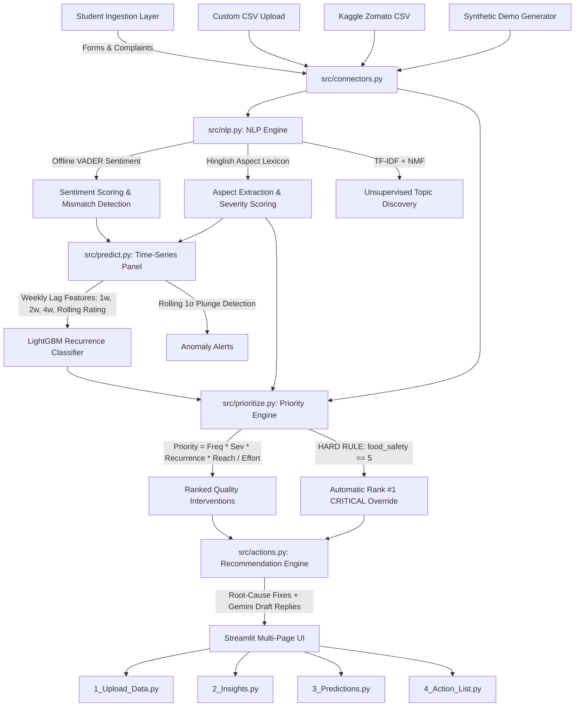

# 🍲 Canteen Copilot

> **AI-Powered Food Feedback & Quality Intelligence Web Application**  
> Built for the Campus Dining & Quality Hackathon.

Canteen Copilot transforms fragmented, qualitative student feedback (forms and complaints) into quantitative sentiment metrics, predictive recurrence risks, and prioritized operational kitchen interventions.

---

## 🎯 Architecture Diagram



---

## 🧪 Planted Patterns & Verification Guide

Canteen Copilot was tested and validated against **8 engineered patterns** injected into the synthetic dataset (`src/data_generator.py`):

| # | Planted Pattern | Operational Cause | Engine Rediscovery Location |
|---|---|---|---|
| **1** | **"Paneer Butter Masala" Friday Freshness** | Mid-week dairy delivery spoils by Friday service. | **Insights Heatmap**: Friday complaints surge to 64%+ of paneer complaints. |
| **2** | **Monday Breakfast Wait Time** | Token queue congestion between 8:00–9:30 AM. | **Insights Heatmap & Prediction**: Monday breakfast wait time is top recurrent bottleneck. |
| **3** | **"Chicken Curry" Week 6 Plunge** | Vendor switch / recipe degradation after midterms. | **Insights Trend & Anomaly**: Rating drops by >1σ from 4.47★ (W1-6) to 1.45★ (W7-12) (-3.02★ drop). |
| **4** | **"Dal Tadka" Recurring Salt Issue** | Inconsistent manual seasoning without measuring tools. | **Predictions & Action List**: Recurring weekly salt complaints with ~97% recurrence probability. |
| **5** | **Food Safety Isolated Events** | Occasional severe contaminants (hair, insect). | **Hard Rule Enforcement**: Immediately pegged to **Rank #1 (Score: 99.0, CRITICAL)**. |
| **6** | **Exam Week Surge (Weeks 5 & 10)** | Elevated student stress drives +35% complaint volume. | **Model Features**: `is_exam_week` feature captures cyclical volume surges. |
| **7** | **Complaint vs. Form Severity** | Formal complaint channel entries are harsher. | **Channel Weighting**: Complaints weighted 2x form submissions in priority scoring. |
| **8** | **Noise & Contradictions (~10% Hinglish, ~3% Mismatches)** | Real-world phrasing ("sambar bahut watery tha", 5★ with angry text). | **NLP Aspect Tagger & Mismatch Table**: Captures Hinglish keywords and isolates rating-text anomalies. |

---

## ⚡ Quickstart & Setup

### 1. Requirements
- Python 3.10+ (Tested on Python 3.11)
- Recommended virtual environment:
```bash
python3 -m venv venv
source venv/bin/activate
```

### 2. Install Dependencies
```bash
pip install -r requirements.txt
```

### 3. Run the App
```bash
streamlit run app.py
```
Open your browser to `http://localhost:8501`.

---

## 🧪 Unit Tests

Run test suite with `pytest`:
```bash
pytest tests/ -v
```
Tests verify:
1. `tests/test_prioritize.py`: Food safety hard-override rule, 2x complaint channel weighting, and explanatory sentence generation.
2. `tests/test_nlp.py`: English and Hinglish keyword aspect extraction, sentiment scoring, and rating-text mismatch detection.

---

## 🎬 3-Minute Hackathon Demo Script

### **Minute 0:00 - 0:45: The Problem & Upload Data**
- *"Judges, college canteen teams receive hundreds of complaints every month across paper slips and Google Forms. But because they are unstructured, problems recur week after week."*
- Navigate to **1_Upload_Data**: Show the Synthetic Generator (or custom CSV upload with column mapper). Mention that we seeded 12 weeks of realistic data containing real-world operational breakdowns.
- Click **Run Analysis** to demonstrate instantaneous ingestion into SQLite and NLP tagging.

### **Minute 0:45 - 1:45: Insights & Pattern Discovery**
- Navigate to **2_Insights**: Show KPI cards (Negative ratio, Top issues).
- Scroll to the **Weekly Rating Trend**: Highlight the red dashed line at Week 6 showing **Chicken Curry** crashing by >3 stars (-3.02★ drop).
- Look at the **Item vs. Day-of-Week Heatmap**: Show how **Paneer Butter Masala** turns dark red specifically on **Fridays** (revealing Thursday dairy spoilage), and **Monday breakfast** lights up with wait-time complaints.
- Show **Rating-Text Mismatches**: Show student reviews that gave 5 stars out of frustration or sarcasm while complaining of watery sambar.

### **Minute 1:45 - 2:30: Recurrence Risk Forecasting**
- Navigate to **3_Predictions**: Explain that Canteen Copilot doesn't just look backward—it trains a **LightGBM** classifier with a strict forward-chaining time split (ROC-AUC ~0.71+).
- Review the **Next-Week Risk Table**: Points out **Dal Tadka (Taste/Salt)** has an 97% probability of recurring next week.
- Review **Feature Importance**: Highlight that 1-week and 2-week lag counts are the strongest predictive signals.

### **Minute 2:30 - 3:00: Action List & The Executive Fix**
- Navigate to **4_Action_List**: The centerpiece of the app!
- Point out that **Food Safety** is automatically forced to **Rank #1 Critical** regardless of frequency.
- Show Action #2: **Dal Tadka Salt Calibration** (Low effort, high impact recipe fix) and Action #3: **Friday Paneer Dairy Sourcing**.
- Click **"Mark as Done"**: Show real-time resolution recording and the **Before vs. After** projection chart estimating a 60% complaint drop.
- Open **"Draft Student Reply"**: Show how the AI drafts a polite, empathetic response ready to send to aggrieved students.
- Conclude: *"Canteen Copilot turns chaotic dining complaints into proactive kitchen solutions."*

---

## 📁 Repository Structure

```
canteen-copilot/
  ├── app.py                  # Main overview & KPI dashboard
  ├── pages/
  │   ├── 1_Upload_Data.py    # Source ingestion & column mapping
  │   ├── 2_Insights.py       # Heatmaps, sentiment trends & NMF topics
  │   ├── 3_Predictions.py    # LightGBM risk predictions & feature weights
  │   └── 4_Action_List.py    # Ranked interventions, mark-done & draft replies
  ├── src/
  │   ├── data_generator.py   # Synthetic data with 8 planted patterns
  │   ├── connectors.py       # Data source adapters (Synthetic, CSV, Zomato, Stubs)
  │   ├── nlp.py              # Offline VADER sentiment, Hinglish aspects, NMF
  │   ├── predict.py          # Panel aggregation, LightGBM & anomaly detection
  │   ├── prioritize.py       # Priority formula & food_safety hard rule
  │   └── actions.py          # Grounded recommendations & Gemini reply drafting
  ├── tests/
  │   ├── test_prioritize.py  # Priority formula unit tests
  │   └── test_nlp.py         # Aspect & sentiment unit tests
  ├── data/                   # SQLite database (canteen.db) & generated CSVs
  ├── requirements.txt        # Production dependencies
  └── README.md               # Architecture, planted patterns & demo script
```
